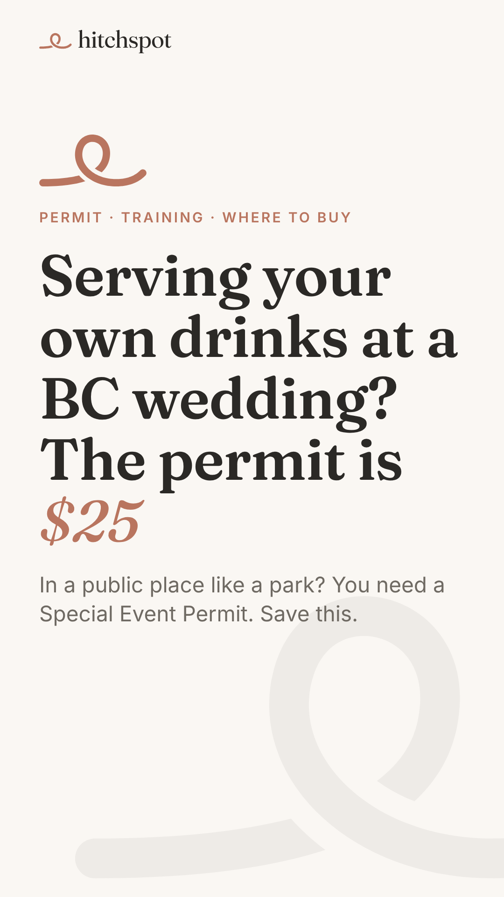
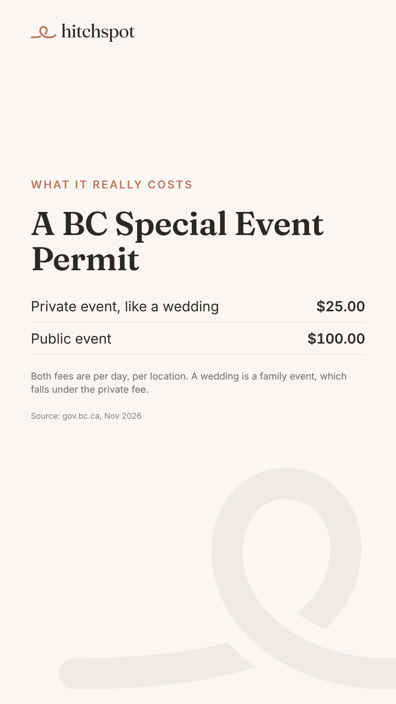
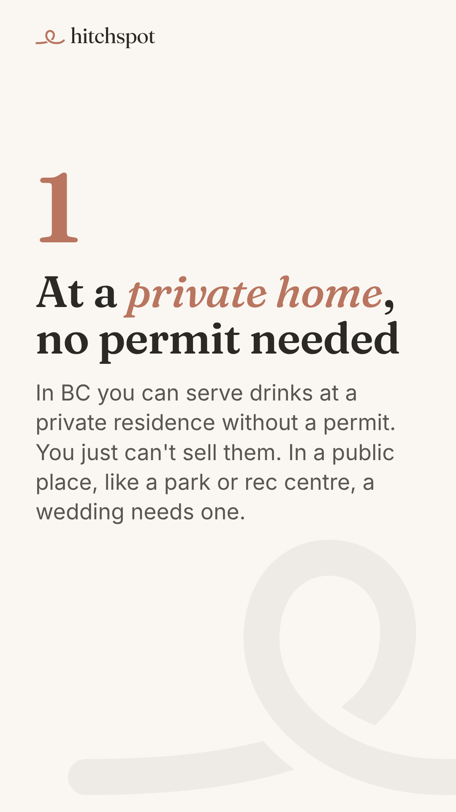
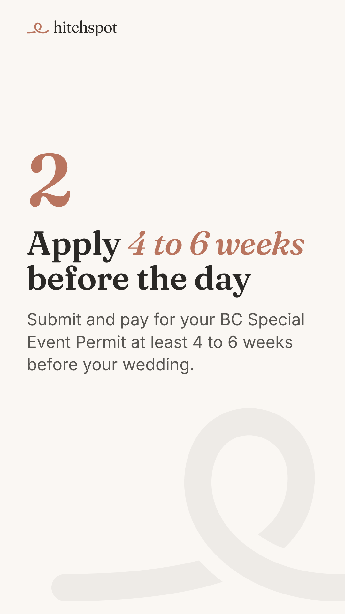
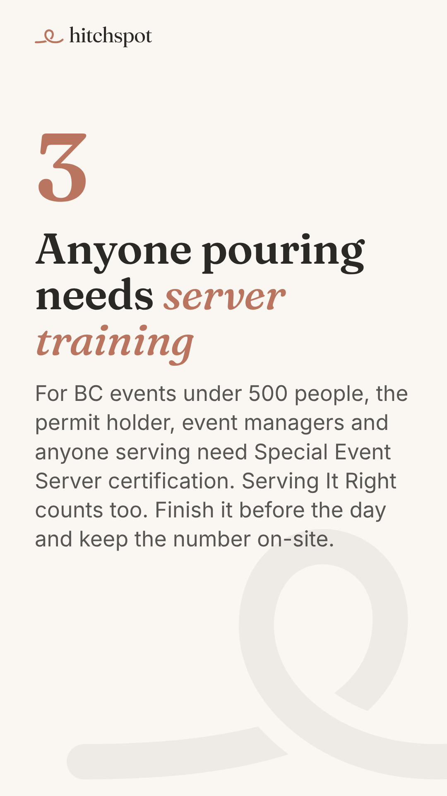
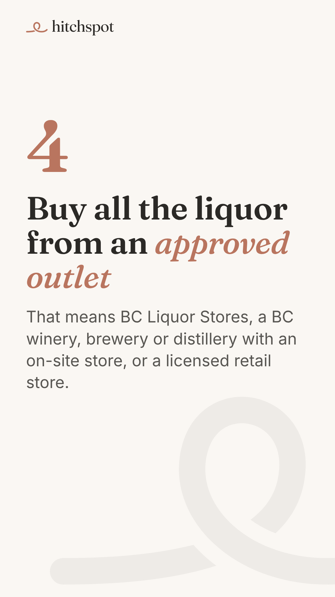
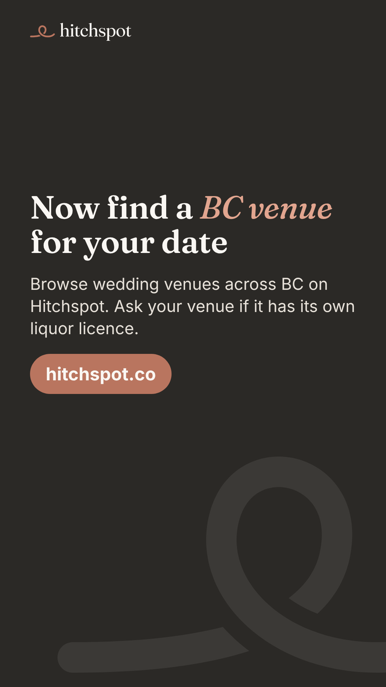
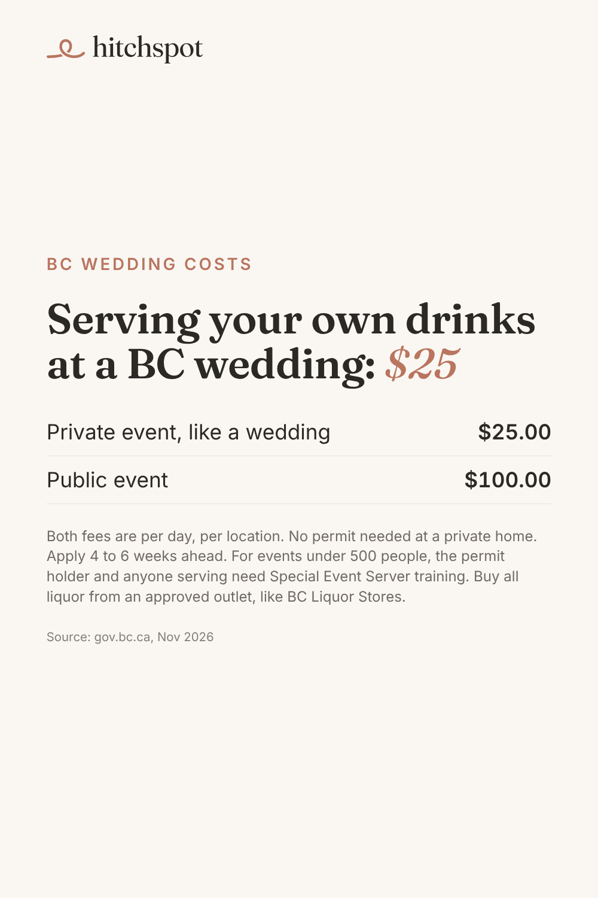

# Today's manual posts: Mon Nov 9, 2026

Posted by Devin from his phone during the warm-up (TikTok until ~Dec 1, Pinterest until Blotato accepts it). Instagram gets today's post automatically at 11:30. No Facebook or YouTube today.

Today's topic is new: the liquor permit for serving your own drinks at a BC wedding ($25 Special Event Permit). All facts are from gov.bc.ca.

Just one TikTok today, so if any earlier days' posts are still waiting, this is a good day to catch up on one of them. Today is the last day of warm-up week 1; from tomorrow Pinterest goes to 2 pins a day.

To save an image on your phone: tap it, then press and hold, then **Save to Photos**. Save them in the order shown.

---

## 1. TikTok (photo carousel): serving your own drinks at a BC wedding, $25 permit

Upload in this order (7 images):

1. 
2. 
3. 
4. 
5. 
6. 
7. 

**Caption** (copy):

```
Serving your own drinks at a BC wedding? The Special Event Permit is $25 for a private event like a wedding, per day and per location. Public events are $100.

At a private home you don't need a permit, but you can't sell drinks. In a public place like a park, you need one. Apply 4 to 6 weeks ahead. For events under 500 people, whoever holds the permit and anyone pouring need Special Event Server training (Serving It Right counts too). Buy all the liquor from an approved outlet, like BC Liquor Stores.

Save this, then find your BC venue on Hitchspot.

#bcwedding #bcbride #vancouverwedding #diywedding #weddingbudget
```

**Settings:** Photo mode · soft instrumental sound · Location: **British Columbia** (or Vancouver, BC) · Content disclosure: **Your brand** · AI-generated: off · Everyone can view.

---

## 2. Pinterest (1 pin), any time today

Image:



On pinterest.com (or the app): **Create**, then **Create Pin**, upload the image, then fill in:

- **Title:** `Serving your own alcohol at a BC wedding: the $25 permit`
- **Description:**
  ```
  Planning a self-serve bar at a British Columbia wedding? In a public place like a park or rec centre, you need a Special Event Permit: $25 for a private event like a wedding, or $100 for a public event, per day and per location. Apply at least 4 to 6 weeks ahead. For events under 500 people, the permit holder and anyone serving need Special Event Server training. Buy all the liquor from an approved outlet, like BC Liquor Stores or a BC winery store. Find your BC wedding venue at hitchspot.co. #bcwedding #bcbride #vancouverwedding #diywedding #weddingbudget
  ```
- **Link:** `https://hitchspot.co/venues?utm_source=pinterest&utm_medium=social&utm_campaign=f2-liquor-permit`
- **Board:** BC Wedding Planning Checklists

Then **Publish**.

---

## 3. 10 minutes of warm-up

On TikTok and Pinterest: search "BC wedding", "backyard wedding BC", "Vancouver Island wedding" and "BC wedding venue". Watch, like and save what's good, and follow a few BC venues.

When done, reply "posted" in the Hitchspot chat (or don't; the next run checks the accounts).

---

## Still waiting on (from Sunday's check-in)

When you have 2 minutes: which of this week's TikToks and pins you actually posted, Instagram and Facebook Insights screenshots for this week's posts, and Blotato's monthly credit allowance on the Starter plan.
