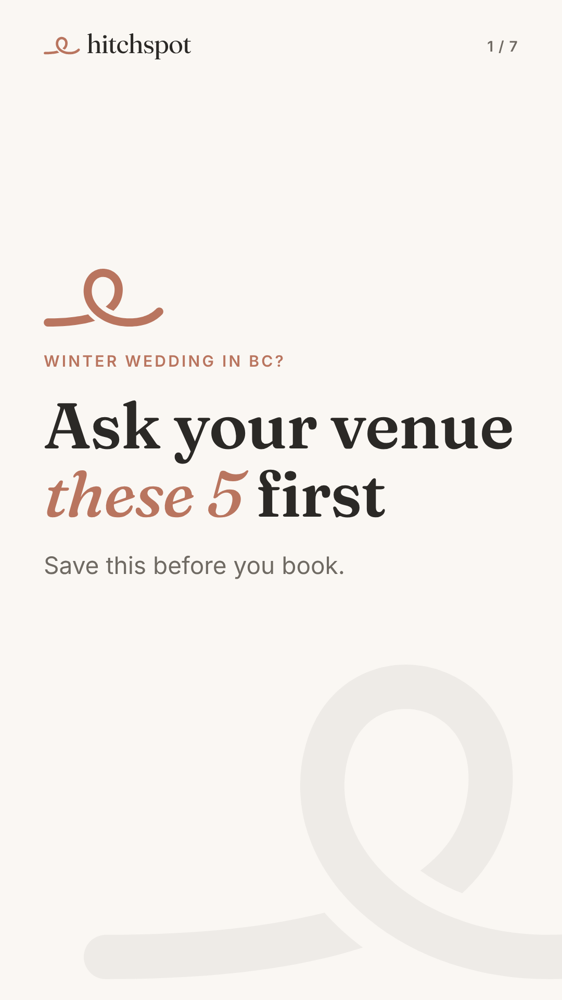
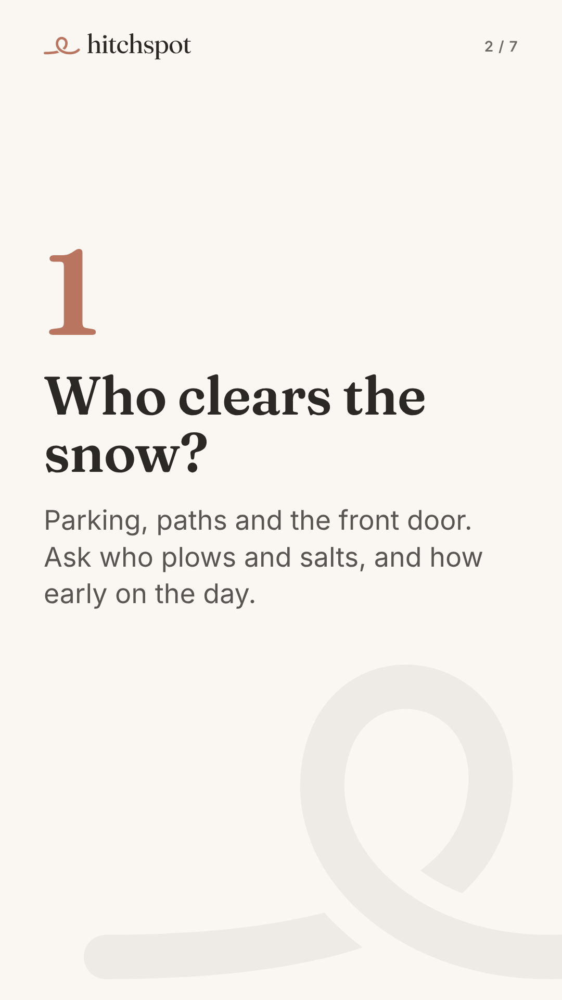
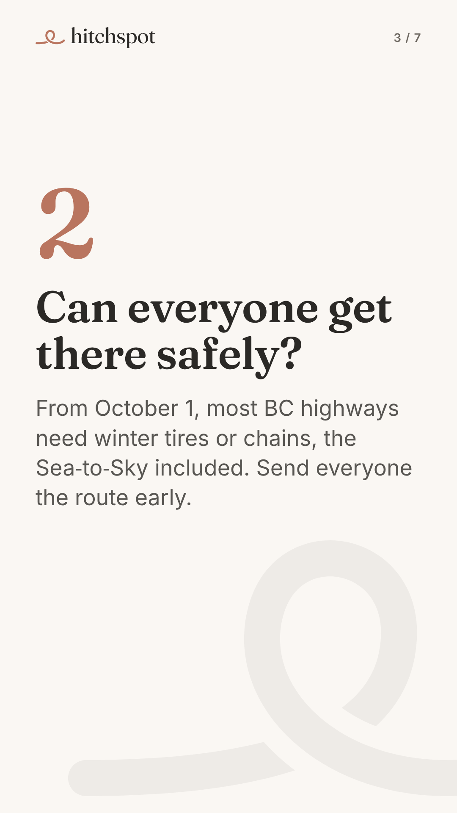
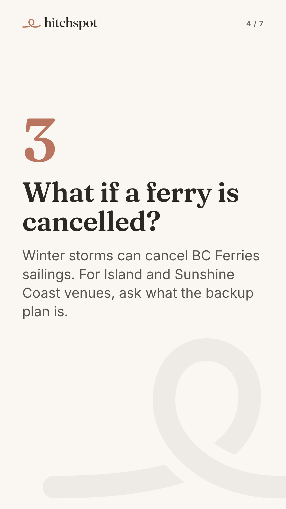
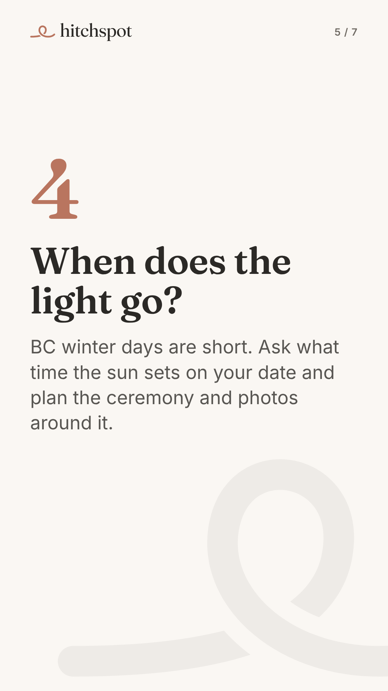
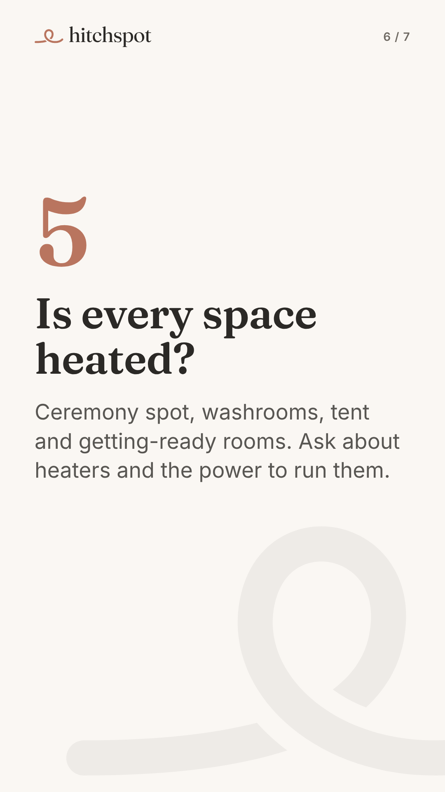
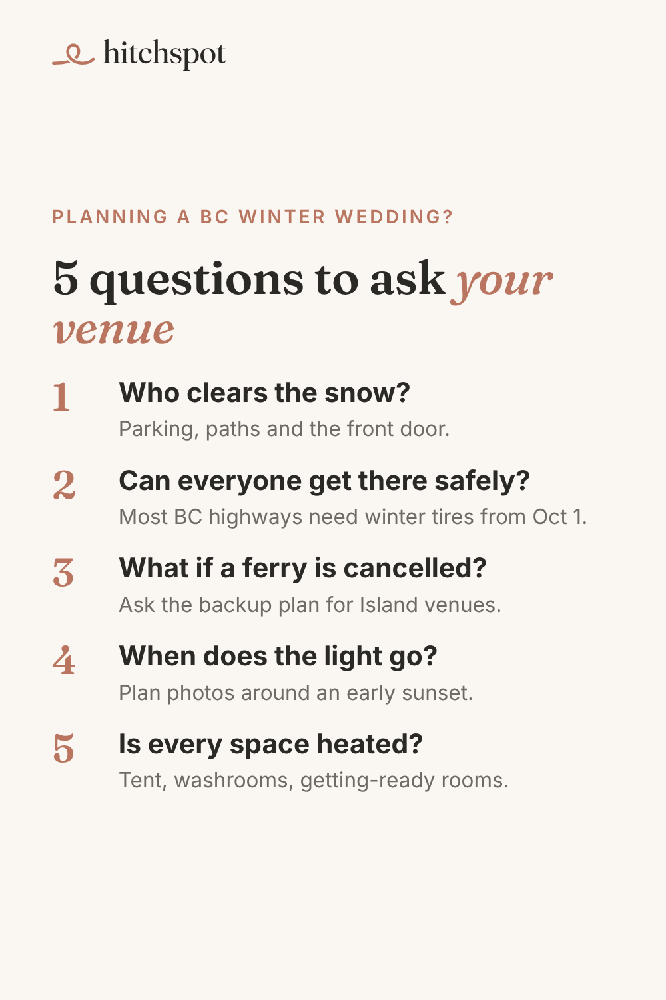

# Today's manual posts: Thu Nov 5, 2026

Posted by Devin from his phone during the warm-up (TikTok until ~Dec 1, Pinterest until Blotato accepts it). Instagram (11:30), Facebook (12:15) and a YouTube Short (17:00) of the same piece go out automatically today.

To save an image on your phone: tap it, then press and hold, then **Save to Photos**. Save them in the order shown.

---

## 1. TikTok (photo carousel), any time today

Upload in this order (7 images):

1. 
2. 
3. 
4. 
5. 
6. 
7. 

**Caption** (copy):

```
Planning a winter wedding in BC? Ask your venue these 5 before you book: snow clearing, winter roads, ferry cancellations, early sunsets and heat.

Find BC venues and ask about your date on Hitchspot.

#bcwedding #winterwedding #seatoskywedding #vancouverislandwedding #bcweddingvenue
```

**Settings:** Photo mode · soft instrumental sound · Location: **British Columbia** (or Squamish, BC) · Content disclosure: **Your brand** · AI-generated: off · Everyone can view.

---

## 2. Pinterest (1 pin), any time today

Image:



On pinterest.com (or the app): **Create**, then **Create Pin**, upload the image, then fill in:

- **Title:** `5 questions to ask your venue before a BC winter wedding`
- **Description:**
  ```
  Planning a winter wedding in British Columbia? Ask your venue who clears the snow, whether everyone can get there on winter roads (most BC highways need winter tires or chains from October 1), what happens if a ferry is cancelled, when the sun sets on your date, and whether every space is heated. Find BC venues and ask about your date at hitchspot.co.
  ```
- **Link:** `https://hitchspot.co/venues?utm_source=pinterest&utm_medium=social&utm_campaign=f4-winter-questions`
- **Board:** BC Wedding Venues

Then **Publish**.

---

## 3. 10 minutes of warm-up

On TikTok and Pinterest: search "BC winter wedding", "Whistler wedding", "Vancouver Island wedding" and "BC wedding venue". Watch, like and save what's good, and follow a few BC venues.

If earlier posts (Hillside Winery and Golden TikToks, the venue-questions and first-3-months pins) did not go up, skip them; today's are the priority.

When done, reply "posted" in the Hitchspot chat (or don't; the next run checks the accounts).
