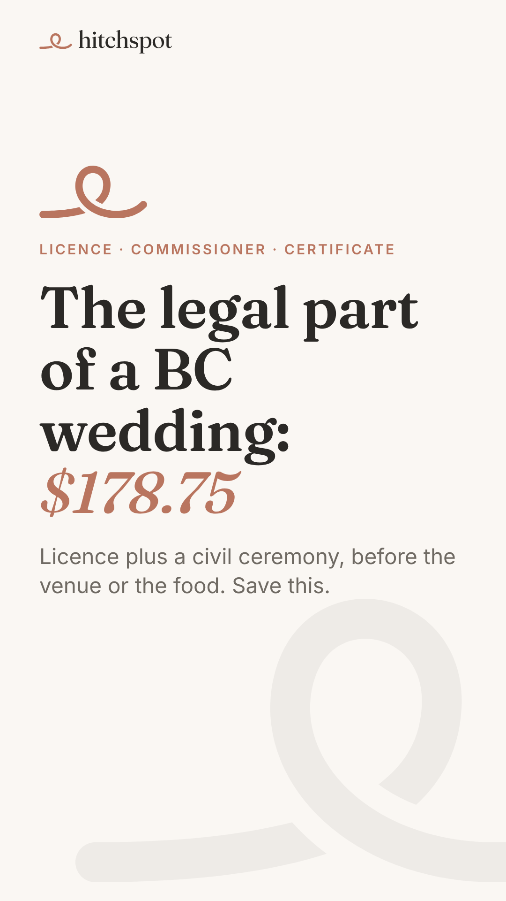
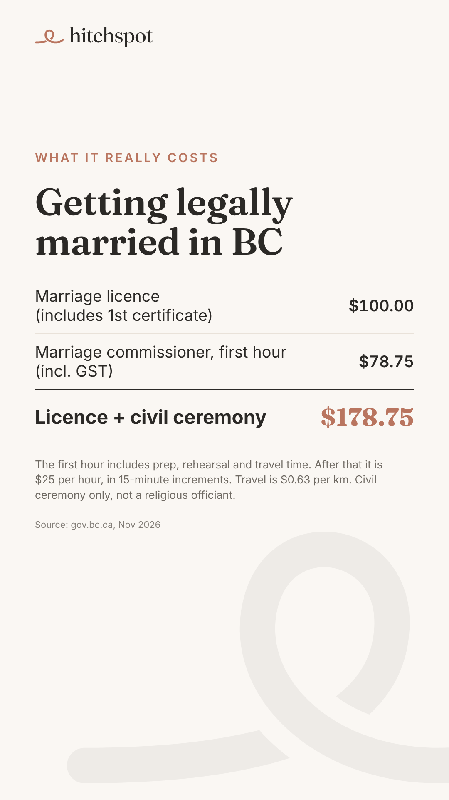
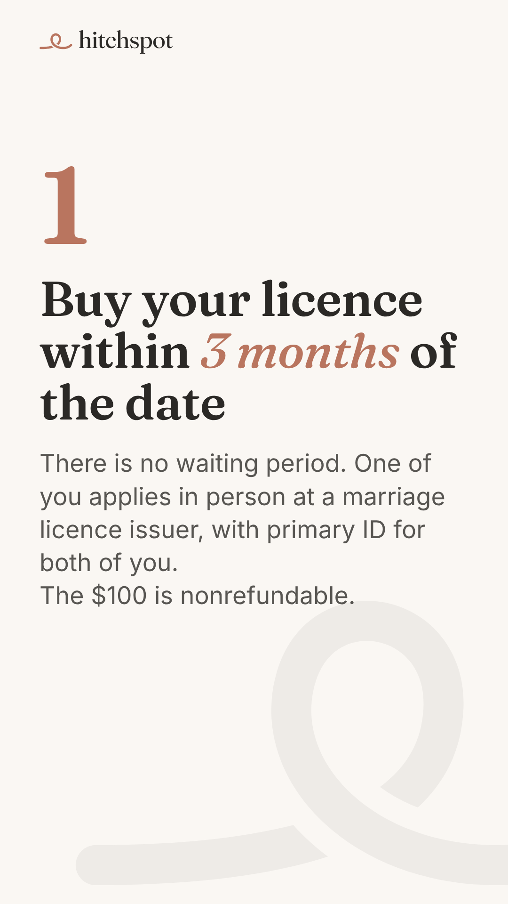
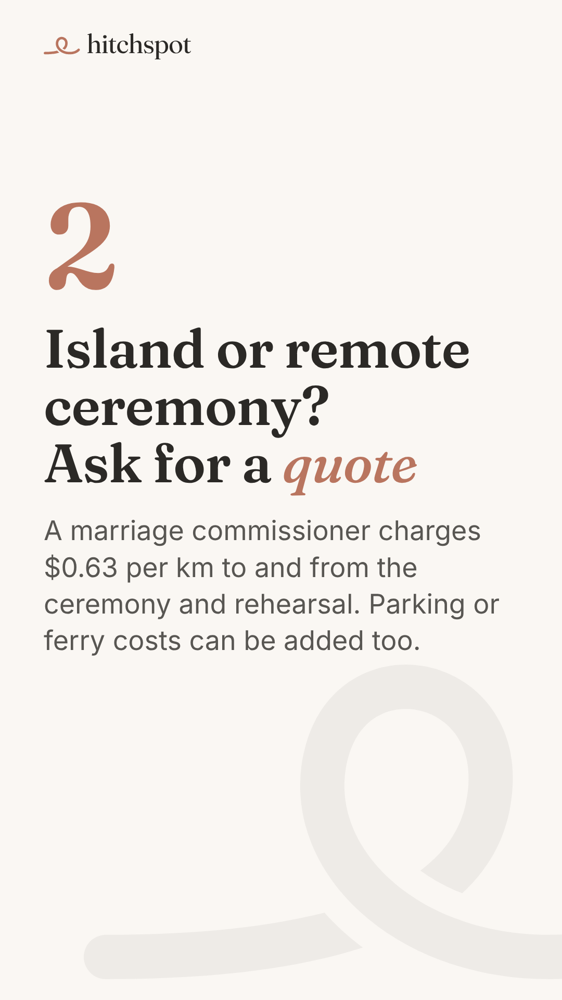
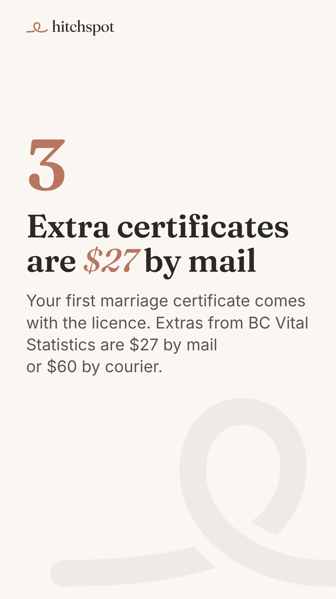
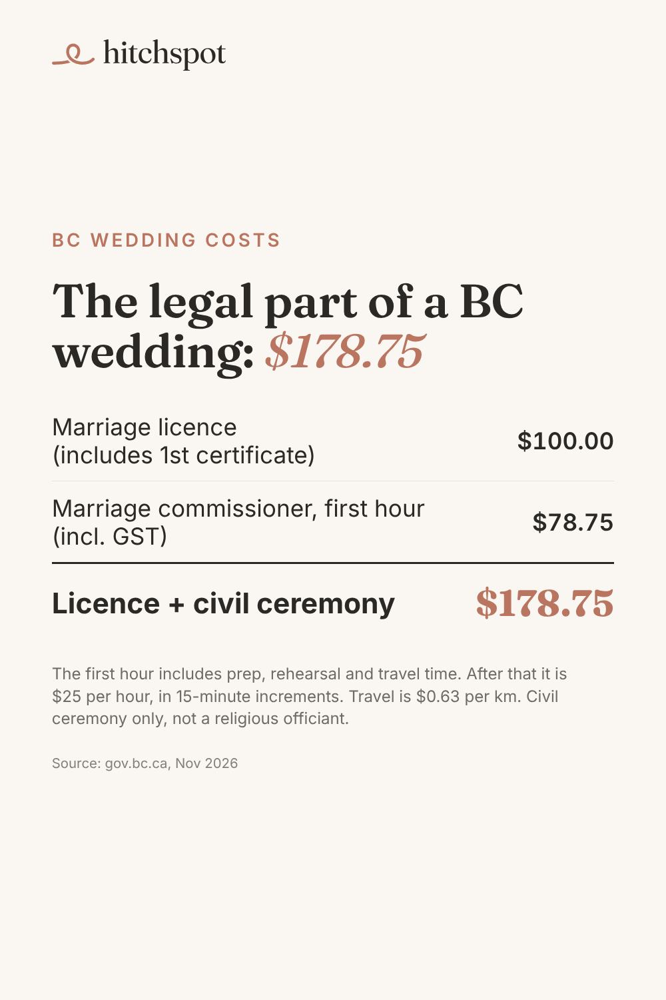

# Today's manual posts: Sun Nov 8, 2026

Posted by Devin from his phone during the warm-up (TikTok until ~Dec 1, Pinterest until Blotato accepts it). Instagram gets today's post automatically at 11:30. No Facebook or YouTube today.

Today's topic is new: what the legal part of a BC wedding costs (marriage licence plus a civil ceremony). All figures are from gov.bc.ca.

Just one TikTok today, so if any earlier days' posts are still waiting, this is a good day to catch up on one of them.

To save an image on your phone: tap it, then press and hold, then **Save to Photos**. Save them in the order shown.

---

## 1. TikTok (photo carousel): the legal part of a BC wedding, $178.75

Upload in this order (6 images):

1. 
2. 
3. 
4. 
5. 
6. 

**Caption** (copy):

```
The legal part of a BC wedding: $178.75. That's a $100 marriage licence (your first certificate is included) plus $78.75 for a marriage commissioner's first hour at a civil ceremony, GST included.

Buy the licence within 3 months of your date. There's no waiting period. Commissioner travel is $0.63 per km, so ask for a quote if you're marrying on an island or somewhere remote.

Save this, then find your BC venue on Hitchspot.

#bcwedding #bcbride #vancouverwedding #weddingbudget
```

**Settings:** Photo mode · soft instrumental sound · Location: **British Columbia** (or Vancouver, BC) · Content disclosure: **Your brand** · AI-generated: off · Everyone can view.

---

## 2. Pinterest (1 pin), any time today

Image:



On pinterest.com (or the app): **Create**, then **Create Pin**, upload the image, then fill in:

- **Title:** `What it costs to get legally married in BC`
- **Description:**
  ```
  Getting married in British Columbia? The legal part costs $178.75 with a civil ceremony: a $100 marriage licence (it includes your first marriage certificate) plus $78.75 for a marriage commissioner's first hour, GST included. Buy the licence within 3 months of your date; there is no waiting period. Commissioner travel is $0.63 per km, and extra certificates are $27 by mail. Find your BC wedding venue at hitchspot.co. #bcwedding #bcbride #vancouverwedding #weddingbudget
  ```
- **Link:** `https://hitchspot.co/venues?utm_source=pinterest&utm_medium=social&utm_campaign=f2-legal-costs`
- **Board:** BC Wedding Planning Checklists

Then **Publish**.

---

## 3. 10 minutes of warm-up

On TikTok and Pinterest: search "BC wedding budget", "getting married in BC", "Vancouver wedding" and "BC wedding venue". Watch, like and save what's good, and follow a few BC venues.

When done, reply "posted" in the Hitchspot chat (or don't; the next run checks the accounts).

---

## Weekly check-in (Sunday)

When you have 2 minutes, reply in the Hitchspot chat with:

- Which TikToks and pins from this week you actually posted (or a screenshot of each profile grid).
- Screenshots of Instagram and Facebook Insights for this week's posts (views and reach per post). Blotato only reads numbers once, at 24h, so the 72h numbers have to come from you for now.
- Blotato's monthly credit allowance on the Starter plan (balance is 1,750), so the low-credit check works.
