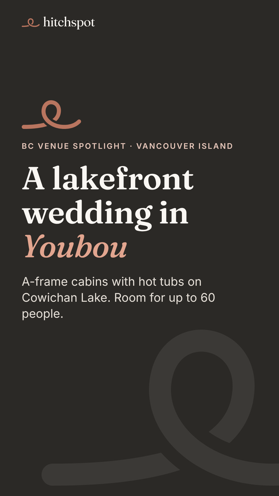
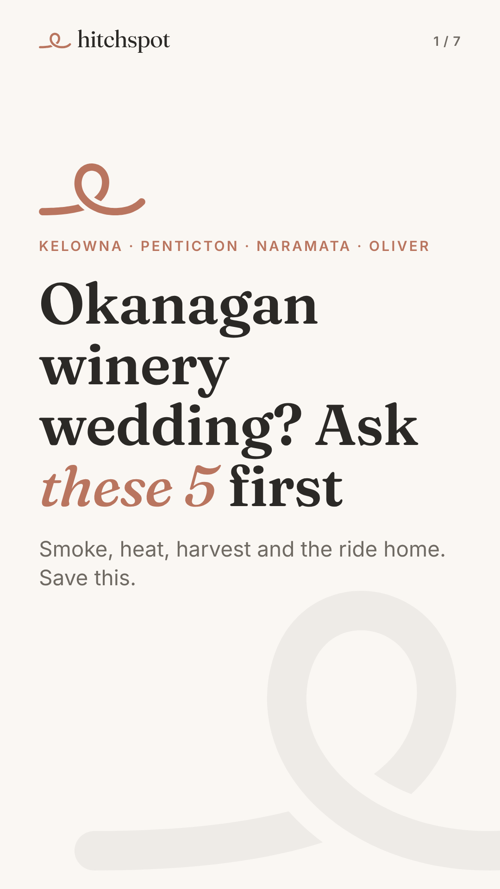
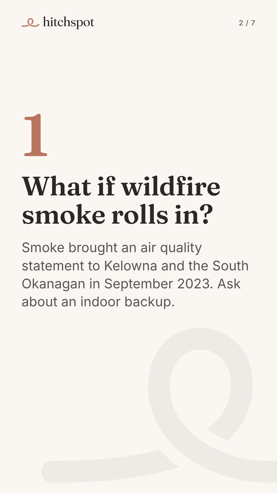
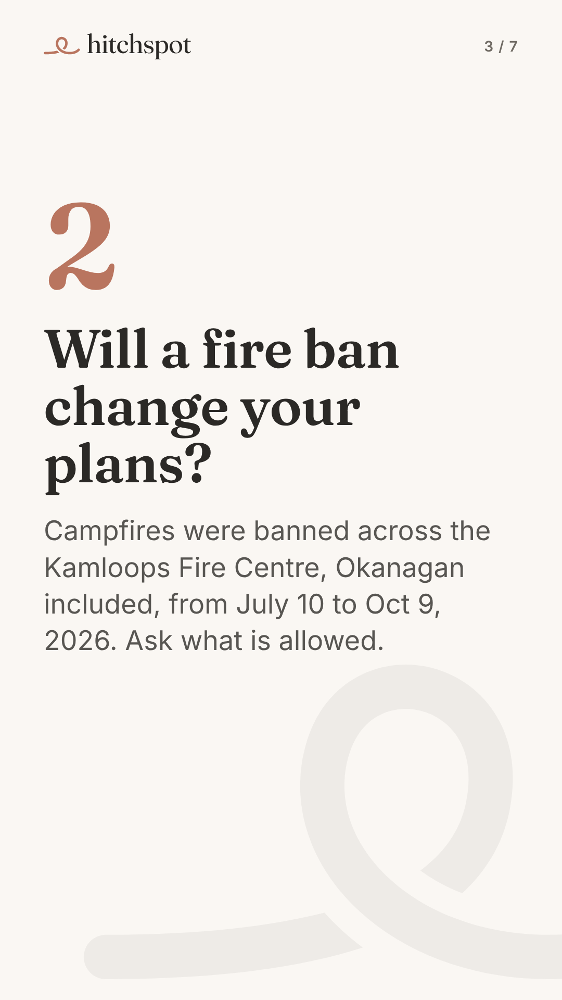
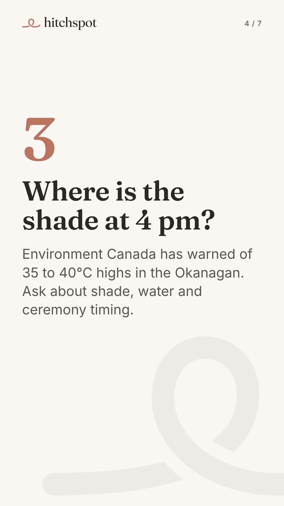
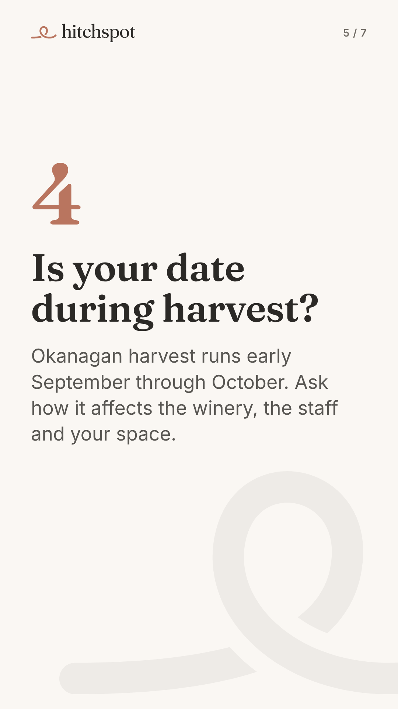
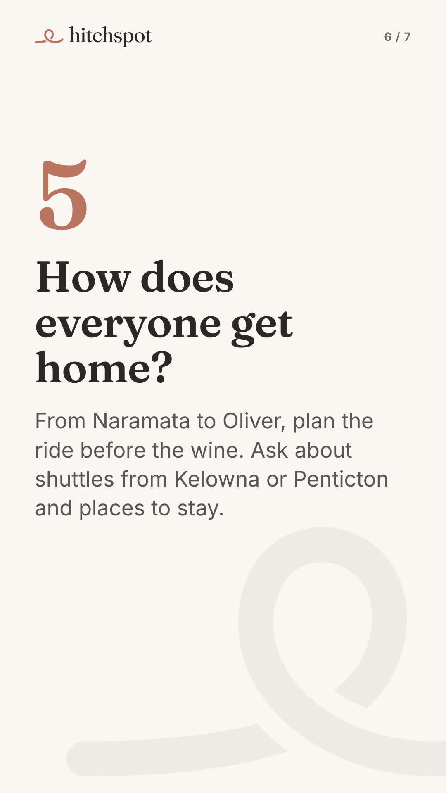
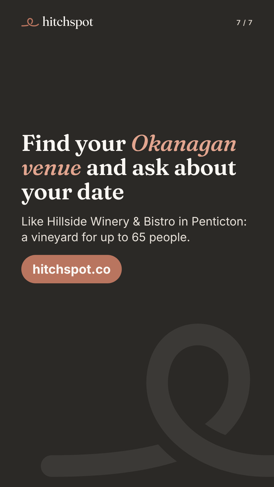
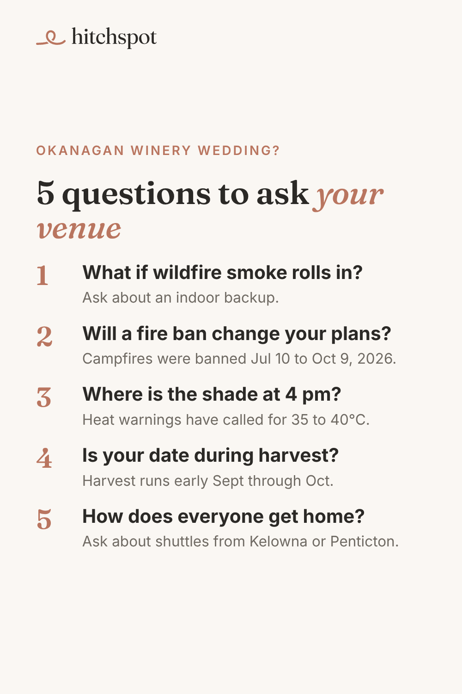

# Today's manual posts: Fri Nov 6, 2026

Posted by Devin from his phone during the warm-up (TikTok until ~Dec 1, Pinterest until Blotato accepts it). Instagram (11:30) and Facebook (12:15) get the Youbou venue post automatically today. No YouTube today.

To save an image on your phone: tap it, then press and hold, then **Save to Photos**. Save them in the order shown.

---

## 1. TikTok (photo carousel): Youbou lakefront venue

Upload in this order (5 images):

1. 
2. 
3. 
4. 
5. 

**Caption** (copy):

```
A lakefront wedding in Youbou, on Cowichan Lake. Luxury Lakefront A-Frame Cabins has A-frame cabins with hot tubs and room for up to 60 people. Swipe for the photos, then check your date on Hitchspot.

Photos: Luxury Lakefront A-Frame Cabins

#vancouverislandwedding #cowichanvalley #bcwedding #lakewedding #bcweddingvenue
```

**Settings:** Photo mode · soft instrumental sound · Location: **Youbou, BC** (or Lake Cowichan, BC) · Content disclosure: **Your brand** · AI-generated: off · Everyone can view.

Quick check before posting: the three listing photos could not be previewed from the cloud. If any of them shows a couple rather than the venue, leave that one out. Also on Instagram/Facebook today, so if one is a problem there, tell me.

---

## 2. TikTok (photo carousel): Okanagan winery questions

Post this one a few hours after the first (or tomorrow morning if the day gets away).

Upload in this order (7 images):

1. 
2. 
3. 
4. 
5. 
6. 
7. 

**Caption** (copy):

```
Planning a summer winery wedding in the Okanagan? Ask your venue these 5 before you book: a smoke backup plan, fire bans, shade in the heat, harvest timing and the ride home from Naramata to Oliver.

Find Okanagan venues like Hillside Winery & Bistro in Penticton on Hitchspot.

#okanaganwedding #kelownawedding #winerywedding #bcwedding
```

**Settings:** Photo mode · soft instrumental sound · Location: **Kelowna, BC** (or Penticton, BC) · Content disclosure: **Your brand** · AI-generated: off · Everyone can view.

---

## 3. Pinterest (1 pin), any time today

Image:



On pinterest.com (or the app): **Create**, then **Create Pin**, upload the image, then fill in:

- **Title:** `5 questions to ask an Okanagan winery wedding venue`
- **Description:**
  ```
  Planning a summer winery wedding in Kelowna, Penticton, Naramata or Oliver? Ask your venue about an indoor backup if wildfire smoke rolls in, what a campfire ban means for your plans (one ran across the Kamloops Fire Centre from July 10 to October 9 in 2026), where the shade is on a 35°C day, how grape harvest (early September through October) affects the winery, and how everyone gets home. Find Okanagan venues and ask about your date at hitchspot.co.
  ```
- **Link:** `https://hitchspot.co/venues?utm_source=pinterest&utm_medium=social&utm_campaign=f4-okanagan-questions`
- **Board:** Okanagan Winery Weddings

Then **Publish**.

---

## 4. 10 minutes of warm-up

On TikTok and Pinterest: search "Okanagan wedding", "Kelowna winery wedding", "Vancouver Island wedding" and "BC wedding venue". Watch, like and save what's good, and follow a few BC venues.

If earlier days' posts did not go up, skip them; today's are the priority.

When done, reply "posted" in the Hitchspot chat (or don't; the next run checks the accounts).
