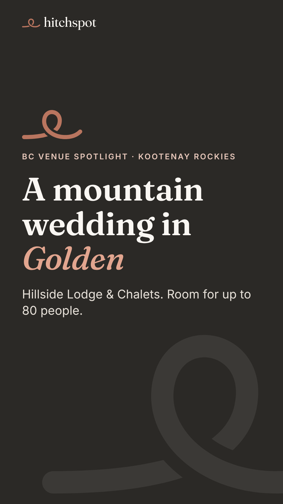
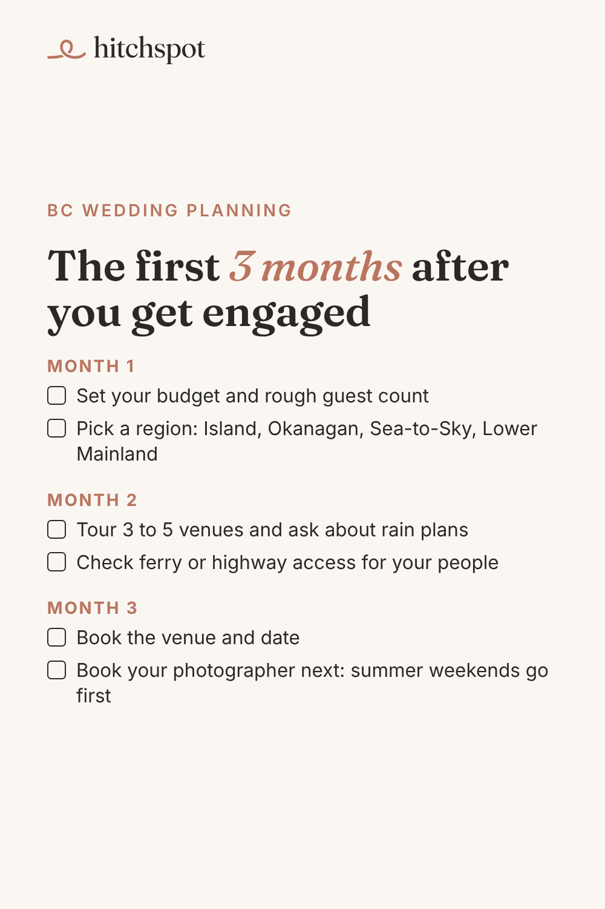

# Today's manual posts: Wed Nov 4, 2026

Posted by Devin from his phone during the warm-up (TikTok until ~Dec 1, Pinterest until Blotato accepts it). Instagram and Facebook are posted automatically today (same Golden venue, 11:30 and 12:15).

To save an image on your phone: tap it, then press and hold, then **Save to Photos**. Save them in the order shown.

---

## 1. TikTok (photo carousel), any time today

Upload in this order (5 images):

1. 
2. 
3. 
4. 
5. 

**Caption** (copy):

```
A mountain wedding in Golden. Hillside Lodge & Chalets hosts up to 80 people. Swipe for the photos, then check your date on Hitchspot.

Photos: Hillside Lodge & Chalets

#goldenbc #kootenaywedding #bcwedding #mountainwedding #bcweddingvenue
```

**Settings:** Photo mode · soft instrumental sound · Location: **Golden, BC** · Content disclosure: **Your brand** · AI-generated: off · Everyone can view.

Quick check before posting: the three listing photos could not be previewed from the cloud. If any of them shows a couple rather than the venue, leave that one out.

---

## 2. Pinterest (1 pin), any time today

Image:



On pinterest.com (or the app): **Create**, then **Create Pin**, upload the image, then fill in:

- **Title:** `The first 3 months after you get engaged: a BC wedding checklist`
- **Description:**
  ```
  Just engaged and planning a wedding in British Columbia? Month 1: set your budget and rough headcount, then pick a region (Vancouver Island, the Okanagan, Sea-to-Sky or the Lower Mainland). Month 2: tour 3 to 5 venues, ask about rain plans, and check ferry or highway access. Month 3: book your venue and date, then your photographer. Find BC venues and ask about your date at hitchspot.co.
  ```
- **Link:** `https://hitchspot.co/venues?utm_source=pinterest&utm_medium=social&utm_campaign=f6-first-3-months`
- **Board:** BC Wedding Planning Checklists

Then **Publish**.

---

## 3. 10 minutes of warm-up

On TikTok and Pinterest: search "Kootenay wedding", "Golden BC wedding", "BC wedding checklist" and "BC wedding venue". Watch, like and save what's good, and follow a few BC venues.

If yesterday's posts (Hillside Winery TikTok, venue-questions pin) did not go up, skip them; today's are the priority.

When done, reply "posted" in the Hitchspot chat (or don't; the next run checks the accounts).
